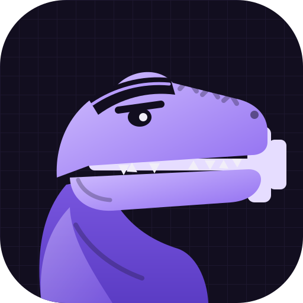
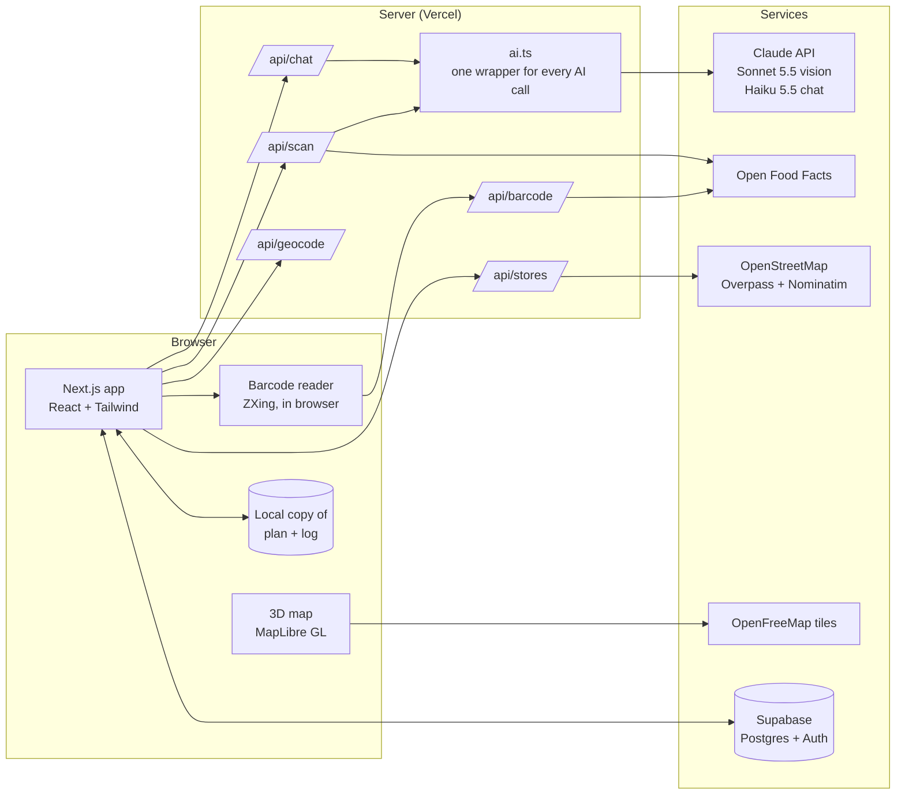

# Gainzville

**Smart protein on a student budget.** Scan a meal, a barcode, or the front of a package, see the protein and what it cost you, and find the best-value protein near campus on a 3D map.

**Live:** [gainzville-ai.vercel.app](https://gainzville-ai.vercel.app) (works best on a phone)

---

## Why I built it

I'm an Information Systems student at the University of Florida. I worked at a gym for two years and I've lifted for years, and the same question kept coming up from students: *how do you hit your protein on a college budget, with a dorm kitchen and a meal plan?*

Calorie apps track what you ate. None of them answer "what's the cheapest way to get 40 more grams today, near me?" Gainzville makes **protein per dollar** the headline number.

## What it does

| Feature | How it works |
| --- | --- |
| **Scan anything** | One camera button. Barcodes are read in the browser and looked up for exact data. Photos of a meal, a nutrition label, or the front of a package go to a vision model, which classifies the image and returns calories, protein, carbs, fat, and a rough cost. |
| **Package photos** | The AI reads the brand and flavor off the front of a package, then the app finds that exact product in the food database (brand must match, US products preferred) so the numbers are real, not guessed. |
| **Honest labels** | Barcode, label, and matched-product results are marked **Verified**. Meal photos are marked **Estimate**, with a "Fix portions" box that re-estimates from text ("that's turkey, double rice") instead of another photo. |
| **3D store map** | A real 3D map of wherever the user is (their location, a ZIP, or one of 25 campuses), with nearby grocery stores as pins. Budget chains are highlighted, and a filter shows budget stores only. |
| **Coach** | A chatbot that reads the user's plan, today's totals, and nearby stores on every message. It answers recipe, store, and lifting-nutrition questions, can change the plan (only after the user taps Confirm), and points the map at the store it recommends. |
| **Onboarding** | A five-step "choose your path" flow (goal, training, stats, budget, location) that sets starting protein and calorie targets. |
| **Installable** | Add to Home Screen on iPhone or Android and it opens full screen like an app, with its own icon. |
| **Accounts** | Passwordless email sign-in. The plan and food log sync across devices. "Delete my account" removes everything. |

## Architecture



### Key decisions

- **Barcode first, AI second.** The browser tries to read a barcode before anything is uploaded. Barcode lookups are free and exact, so the expensive vision call only happens for meals, labels, and package fronts.
- **Cheap checks before paid calls.** The browser rejects photos that are nearly black or completely blurred, and shrinks images before upload. Corrections are text-only, which costs a fraction of a new image.
- **Right-sized models.** A larger vision model reads photos, where accuracy matters. A small, fast model runs the chat, where speed and cost matter. Every AI call goes through one file (`src/lib/ai.ts`), so a model or provider can be swapped in one line.
- **Structured outputs.** The vision model returns JSON that must match a schema, so the app never parses free text.
- **The model suggests, the user decides.** The coach can *propose* a plan change, but nothing changes until the user taps Confirm. The server also enforces a calorie floor (1,500 kcal, 1,800 for under-18s) no matter what the model asks for.
- **Local first.** The app reads from a copy in the browser, so it's fast and works offline. Signed-in users also get every change written to Supabase.
- **Security in the database, not just the app.** Row level security means each user can only read or write their own rows, enforced by Postgres even if the app has a bug. API keys live only on the server.
- **Free, open data where possible.** Maps, store locations, and food data all come from open sources with no paid API keys.

### Safety and privacy

- The coach adapts to specific goals instead of refusing, but holds a calorie floor and responds with care (and support resources) when someone describes disordered eating.
- No medical claims. Contested ideas are presented as one approach, not fact.
- Meal photos are analyzed and never stored.
- Location is a ZIP, a campus, or a point rounded to about 1 km. Never continuous tracking.
- Daily limits on AI scans and chat keep a public demo from running up costs.

## Tech stack

Next.js 16 (App Router) · React 19 · TypeScript · Tailwind CSS 4 · Claude API (Sonnet 5.5, Haiku 5.5) · Supabase (Postgres, Auth, row level security) · MapLibre GL + OpenFreeMap · Open Food Facts · OpenStreetMap · ZXing · Vercel

## Run it locally

```bash
npm install
cp .env.example .env.local   # then add your keys
npm run dev
```

You'll need an Anthropic API key and a Supabase project (run `supabase/schema.sql` in its SQL editor).

## Roadmap

- Pilot with lifters at UF and collect feedback
- User-submitted prices for real local protein-per-dollar numbers
- Paid tier with unlimited scans

## Data sources and credits

Food data from [Open Food Facts](https://world.openfoodfacts.org) (ODbL). Map data © [OpenStreetMap](https://www.openstreetmap.org/copyright) contributors, tiles from [OpenFreeMap](https://openfreemap.org) and [OpenMapTiles](https://openmaptiles.org). Nutrition guidance is general information, not medical advice.

---

Built by Michael Rush, using Claude Code as an AI pair programmer.
